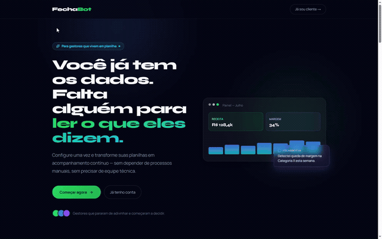
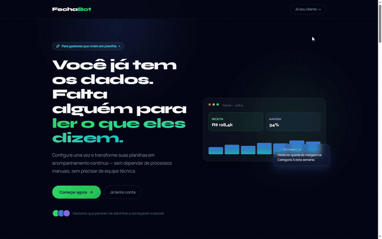
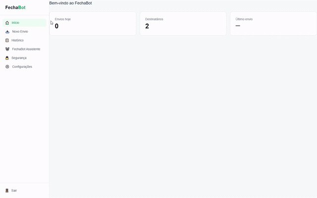
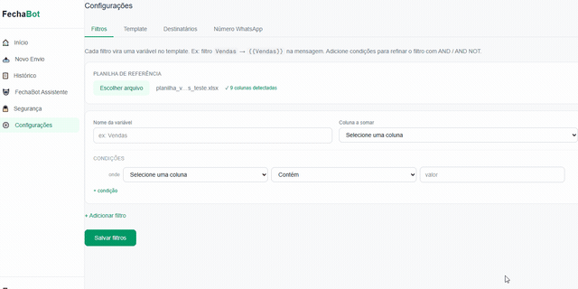
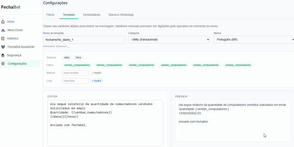
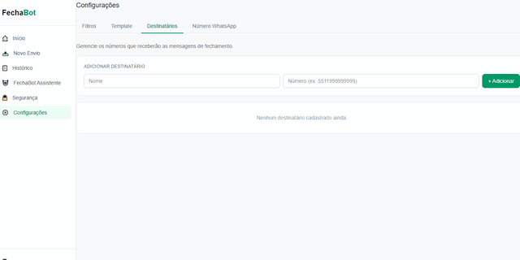
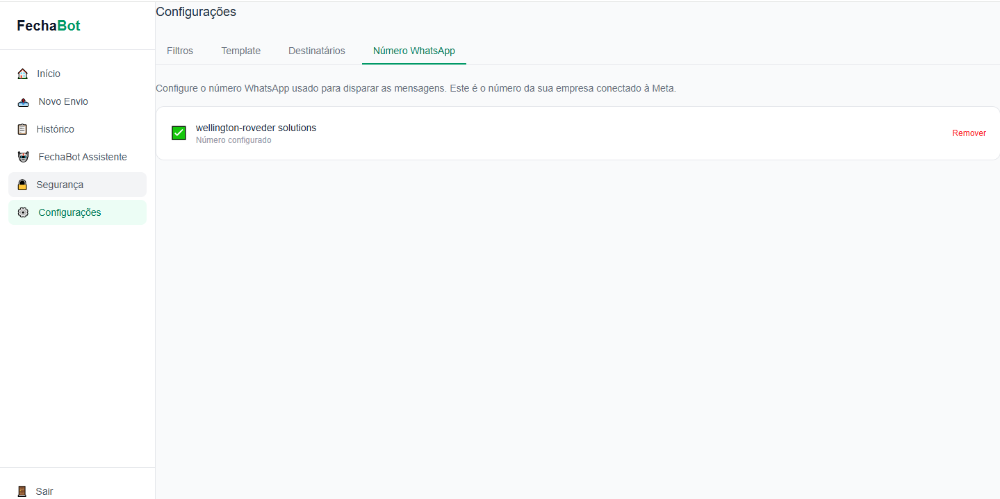
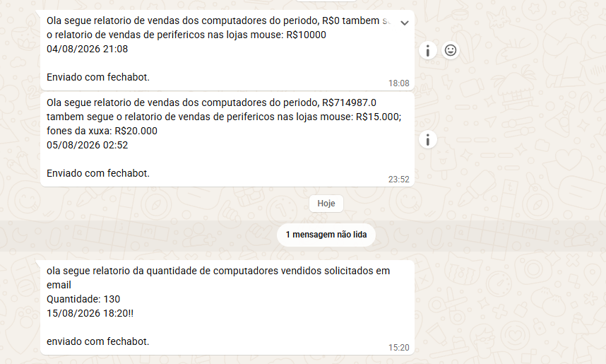
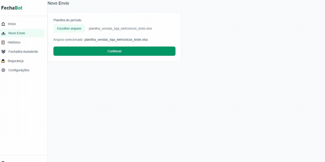
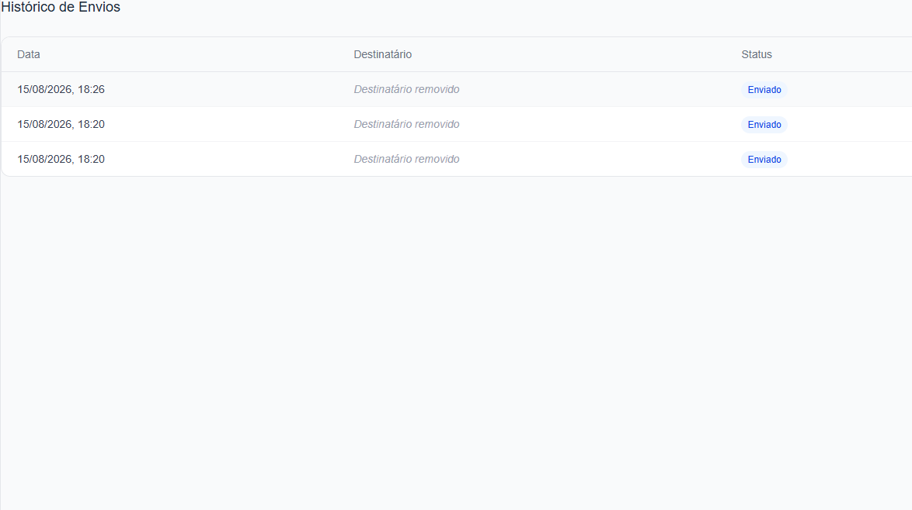

<p align="center">
  
</p>

<p align="center">
  Estudo de caso sobre a arquitetura, a evolução e a validação de uma
  plataforma de fechamentos operacionais integrada ao WhatsApp.
</p>

<p align="center">
  <a href="https://wellington-roveder.github.io/portifolio-Wellington-Roveder/">
    
  </a>
  <a href="https://www.linkedin.com/in/wellington-roveder-04637b37b/">
    
  </a>
  <a href="https://github.com/Wellington-Roveder">
    
  </a>
</p>

> **Transparência:** este repositório é um estudo de caso. O código-fonte
> do FechaBot é privado; estão disponíveis aqui a documentação técnica,
> as decisões de arquitetura, o histórico de evolução e as evidências
> visuais de uso. As imagens e os vídeos utilizam dados de teste.

## Visão geral

O FechaBot transforma planilhas operacionais em fechamentos distribuídos
por WhatsApp. O usuário envia a planilha, aplica filtros configuráveis,
seleciona um modelo de mensagem e acompanha o processamento e o histórico
de cada envio.

O sistema foi concebido para pequenos e médios negócios que precisam
distribuir informações operacionais com rapidez, mas não dispõem de uma
estrutura dedicada de dados ou automação.

## Principais capacidades

| Capacidade | Descrição |
|---|---|
| Processamento de planilhas | Leitura da fonte original e aplicação de filtros configuráveis |
| Modelos de mensagem | Variáveis de sistema, filtro, lista e preenchimento manual |
| Envio assíncrono | Processamento por fila, retentativas automáticas e registro de cada tentativa |
| Integração com WhatsApp | Entrega por meio da Meta Cloud API |
| Histórico operacional | Consulta de envios, destinatários e resultados do processamento |
| Consulta dos dados | Interação em linguagem natural com os dados do próprio tenant |
| Isolamento por tenant | Separação dos dados e das operações entre clientes |

<p align="center">
  
</p>

## Tecnologias e integrações

<p align="left">
  
  
  
  
  
  
  
  
</p>

As integrações externas são a Meta Cloud API, para envio pelo WhatsApp,
e a Claude API, para a consulta conversacional dos dados. Os testes de
integração utilizam PostgreSQL real, sem mocks de banco.

## Demonstração

As demonstrações abaixo mostram fluxos do produto em funcionamento. As
mensagens e os destinatários exibidos são de teste.

### Acesso e autenticação em duas etapas

Sessão baseada em cookie `httpOnly`, proteção CSRF e autenticação TOTP
como segunda etapa. A decisão está documentada no
[ADR 001](./decisions/001-modelo-sessao-cookie-csrf-redis.md).

<p align="center">
  
</p>

### Dashboard

Visão do dashboard, consulta dos dados, segurança da conta e configurações.

<p align="center">
  
</p>

### Configuração de filtros

Upload da planilha de referência, identificação de colunas e configuração
de condições compostas.

<p align="center">
  
</p>

### Modelos de mensagem

Editor com variáveis disponíveis, visualização em tempo real e valores de
exemplo para validação antes do envio.

<p align="center">
  
</p>

### Destinatários e número de WhatsApp

<p align="center">
  
  <br/><br/>
  
</p>

### Validação ponta a ponta

O fluxo foi validado da planilha até a entrega de uma mensagem em um
WhatsApp real, utilizando um modelo aprovado pela Meta.

<p align="center">
  
</p>

### Novo envio e histórico

<p align="center">
  
</p>

<p align="center">
  
</p>

Os destinatários foram removidos após os testes. O histórico apresenta
essa alteração como “Destinatário removido”, comportamento previsto no
produto.

## Destaques técnicos

- **Sessões revogáveis:** cookie `httpOnly`, proteção CSRF, allowlist de
  sessão no Redis e expiração controlada, sem depender apenas do JWT no
  cliente.
- **Separação de categorias de template:** `requested_category` registra
  a escolha original e `effective_category` registra a categoria vigente
  após a análise da Meta.
- **Processamento resiliente:** Celery, retentativas automáticas e
  persistência do resultado de todas as tentativas, inclusive falhas.
- **Isolamento multi-tenant:** cada registro possui `tenant_id` e as
  rotas autenticadas obtêm o escopo a partir da sessão, não de parâmetros
  enviados pelo cliente.
- **Segurança documentada:** revisão em fases, achados técnicos,
  correções e riscos residuais registrados em [`security/`](./security).

## Como o repositório está organizado

```text
fechabot-case-study/
├── README.md            documentação principal e demonstrações
├── banner.svg           imagem de apresentação
├── architecture/       arquitetura, componentes e fluxo de dados
├── decisions/           decisões técnicas, alternativas e trade-offs
├── security/            revisões de segurança e achados documentados
├── roadmap/             entregas concluídas, plano e débitos técnicos
└── media/
    ├── screenshots/     capturas do produto
    └── videos/          GIFs de fluxos completos
```

## Documentação

- [Arquitetura e fluxo de dados](./architecture/README.md)
- [Decisões de arquitetura](./decisions/README.md)
- [Revisão de segurança](./security/README.md)
- [Roadmap e débitos técnicos](./roadmap/README.md)

## Escopo atual

O produto possui um fluxo funcional validado, mas não é apresentado como
um SaaS pronto para operação comercial. Permanecem no planejamento:
onboarding self-service, cobrança recorrente, monitoramento, deploy de
produção, agendamento recorrente, LGPD formal e a integração via Embedded
Signup da Meta.

O status detalhado e os débitos conhecidos estão no
[roadmap](./roadmap/README.md). O repositório não contém instruções de
execução porque a implementação principal é privada.

## Sobre o projeto

O FechaBot foi desenvolvido como um projeto prático de arquitetura,
integração e segurança de aplicações web. O objetivo deste repositório é
tornar as decisões e os resultados verificáveis, incluindo limitações,
pendências e evidências do fluxo principal.

<p align="left">
  <a href="https://wellington-roveder.github.io/portifolio-Wellington-Roveder/">
    
  </a>
  <a href="https://www.linkedin.com/in/wellington-roveder-04637b37b/">
    
  </a>
  <a href="https://github.com/Wellington-Roveder">
    
  </a>
</p>
